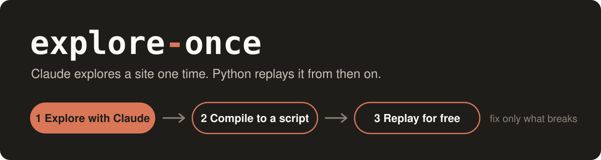

<p align="center">
  
</p>

<p align="center">
  <a href="https://github.com/PRODHOSH/explore-once/actions/workflows/ci.yml"></a>
  
  <a href="LICENSE"></a>
  
  
</p>

Browser skills for Claude that move repetitive work out of the model and into Python scripts.

## The problem

When Claude drives a browser, it re-reads the page on every click. Do the same task five times and you pay for the same page reads five times. Some jobs Claude cannot do at all on its own, like making an image, so it ends up clicking through ChatGPT or Gemini one screenshot at a time.

## What this does about it

Let Claude work out the task once. Save the working path as a short Python script. Run the script from then on, and call Claude back only when a website changes and one step breaks.

## The skills

| Skill | What it gives you |
|---|---|
| [`browser-script-compiler`](skills/browser-script-compiler) | The core loop: explore, compile, replay, repair. Keeps a library of your flows so the next session reuses them. Also works for browser tests. |
| [`web-image-generation`](skills/web-image-generation) | Claude cannot make images. Your signed-in ChatGPT or Gemini can. A script sends the prompt, waits, and saves the file. |
| [`gallery-harvest`](skills/gallery-harvest) | Point it at a Dribbble style page. It collects the images and gives Claude a few numbered contact sheets instead of 80 separate looks. |
| [`form-filler`](skills/form-filler) | Built for developers filling recruitment, internship and club forms. Remembers your real projects, writes answers in your voice, and never invents a number. Stops for your approval before anything is submitted. |
| [`ui-regression-suite`](skills/ui-regression-suite) | Checks every page at desktop and mobile size for errors, broken images, overflow and visual changes, and shows Claude only what failed. |

## The numbers

| | Measured or estimated | Result |
|---|---|---|
| Automated checks, run on local test pages | Measured | 53 passing |
| Reviewing an 80 shot gallery | Estimated | about 18k image tokens instead of about 109k (roughly 6x fewer) |
| What a script run returns to Claude | Measured in test runs | one JSON line: 17 and 32 tokens for two sample runs, a few more with long file paths |

The gallery estimate uses image tokens of about width x height / 750. Eighty separate 1280x800 screenshots come to about 109k. Five contact sheets plus five full size originals come to about 18k. Your pages will differ, so measure your own tasks. Nothing here has been benchmarked against live sites yet.

## Quick start

```bash
/plugin marketplace add PRODHOSH/explore-once
/plugin install explore-once@explore-once
python3 -m pip install playwright pillow
```

You can also copy any folder from `skills/` into `~/.claude/skills/`. Each skill stands alone.

The scripts use their own Chrome profile, because Chrome 136 and later ignore the debugging switch on your everyday profile. Open it once and sign in to the sites you use:

```bash
python3 skills/browser-script-compiler/scripts/flowkit.py start https://chatgpt.com
```

## Safe by design

- Anything that sends, submits or posts stops for your approval first. Form submission needs a code tied to the exact page and data you reviewed.
- Passwords, card details and CAPTCHAs are always left to you.
- Your profile and logins stay on your machine.
- Answers written for forms are checked for em dashes, stock phrases and numbers that are not in your profile.

## Status

The scripts and tests run against local test pages. The selectors for ChatGPT, Gemini and Dribbble have not been checked on the live sites yet, so the first real run may need a one line fix. Issues and pull requests for that are the most useful thing you can send. See [CONTRIBUTING.md](CONTRIBUTING.md).

## Author

<a href="https://github.com/PRODHOSH"></a>

**PRODHOSH V.S**, building things people actually use.

[GitHub](https://github.com/PRODHOSH) · [Website](https://prodhosh.me) · [LinkedIn](https://www.linkedin.com/in/prodhoshvs)

<br clear="left">

## License

[Apache 2.0](LICENSE). If you reuse or build on this, keep the [NOTICE](NOTICE) file so the credit travels with it.

Not affiliated with Anthropic. Claude is a trademark of Anthropic.
